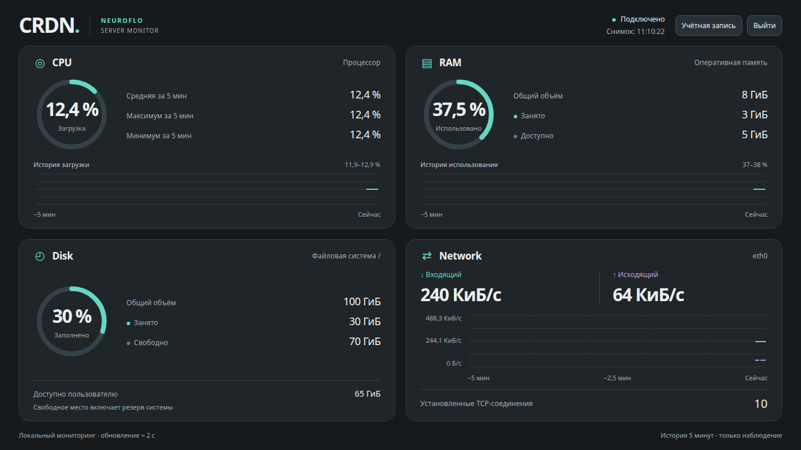

# CRDN — Server Monitor

**A lightweight Linux server monitoring dashboard, right in your browser.**

CRDN displays CPU usage, memory usage, disk space and network activity in real time.

No Docker, external monitoring services or heavyweight databases.

**Documentation language:** [Русский](README.md) | English

[GitHub](https://github.com/GreyByDefault/CRDN-PUBLIC) · [Releases](https://github.com/GreyByDefault/CRDN-PUBLIC/releases)

**Current release: v1.0.0-rc.5 is a Pre-release; the installer is undergoing acceptance testing. Stable v1.0.0 has not been released yet.**

## What CRDN looks like



*The existing dashboard interface, captured locally with demonstration values; no production server data or secrets.*

### Features

- **CPU** — current, average, minimum and maximum processor usage.
- **RAM** — total, used and available memory.
- **Disk** — total, used and free disk space.
- **Network** — incoming and outgoing rates and established TCP connection count.
- Metrics refresh every 2 seconds.
- Charts show the last 5 minutes of history.
- A convenient interface for computers and smartphones.
- Login with a username and password, which can be changed in account settings.

CRDN is designed for observing your server. It does not manage system resources or change their settings.

---

## 1. What you need for installation

To install CRDN, you need:

- A VPS/VDS, dedicated server or your own Linux server.
- Ubuntu Server 22.04, 24.04, 26.04 LTS or Debian 12/13.
- Administrative SSH access to the server.
- A domain or subdomain.
- An internet connection on the server.

These are target systems, with systemd. Debian 12 was used to test installation components, updates, rollback and removal, as well as Caddy/Nginx/Apache configurations. On our Ubuntu 24.04 server, applicability was checked without installation. Full installation with certificate issuance/renewal and the entire OS list have not completed acceptance testing yet.

Commands require Python 3, curl, sha256sum, tar and standard system tools. The bootstrap fetches the script bundle itself; there is no need to download sources, extract an archive or choose a directory manually. Commands work as root or as a user with sudo; a sudo password prompt is normal.

CRDN runs on Linux servers. Standard shared web hosting is not supported.

Installation does not require Docker, a separate database or a paid monitoring service.

## 2. Setting up your domain

**Before installing CRDN, point your domain to your server's IP address.**

Configure this in your domain's DNS management panel — for example, REG.RU, Cloudflare or another service that hosts your DNS.

You can find the server's IP address in the account dashboard of the provider from which you rent your VPS.

Two options are shown below. Choose the one that suits you.

### Option A. Install on the main domain

Suppose you purchased this domain:

`example.com`

And want CRDN to open directly at:

`https://example.com`

Open your DNS settings and add this record:

| Field | Value |
|---|---|
| Record type | `A` |
| Name | `@` |
| Value | `203.0.113.10` |
| TTL | Default |

`@` means the main domain.

Some DNS providers use an empty field or the domain name itself instead of `@`. Follow the notation used in your provider's panel.

`203.0.113.10` is an example. Replace it with **your server's actual public IPv4 address**.

After you save the record, `example.com` will point to the specified server.

**Important:** if a website already runs on the main domain, installing CRDN at that address will require changes to the existing configuration. A separate subdomain is more convenient for the dashboard.

### Option B. Install on a subdomain

Suppose you purchased this domain:

`example.com`

And want to host CRDN at:

`https://monitor.example.com`

Open your DNS settings and add this record:

| Field | Value |
|---|---|
| Record type | `A` |
| Name | `monitor` |
| Value | `203.0.113.10` |
| TTL | Default |

Here, `monitor` is the subdomain name.

You can choose another name, such as `server`, `status` or `crdn`.

In the value field, enter **your server's actual public IPv4 address**.

After you save the record, your main website will continue to work at `example.com`, while `monitor.example.com` will point to the same server.

**We recommend a dedicated subdomain for CRDN.**

### How long does DNS take to update?

Usually you can start checking after 10–15 minutes. In some cases, updates take several hours.

The CRDN installer automatically checks where your domain points.

If DNS has not updated yet or points to another server, installation stops with a clear message.

Once you fix DNS, simply run the installation command again.

If the domain has an AAAA record, it must also point to a public IPv6 address assigned to this server. The installer checks every A/AAAA record; automated installation through NAT/CDN is not supported. Inbound TCP 80/443 must be open beforehand: scripts do not change firewall rules or other network settings.

## 3. Connecting to your server

To install CRDN, connect to your Linux server over SSH.

**Windows:** open PowerShell or Windows Terminal.

**Linux and macOS:** open Terminal.

Enter:

```bash
ssh root@203.0.113.10
```

Replace `203.0.113.10` with your server's IP address.

If your provider gave you a different username, use it instead of `root`. Installation requires administrator privileges through `sudo`.

On your first connection, SSH may ask you to confirm the host key. Compare its fingerprint with the information supplied by your provider.

Once connected, you can proceed to CRDN installation.

<a name="installation"></a>

## 4. Installing CRDN

Copy the installation command and run it on the server.

```sh
bash -o pipefail -c 'curl --fail --location --proto =https --proto-redir =https https://neuroflo.ru/crdn-files/releases/v1.0.0-rc.5/crdn-bootstrap.sh | sh -s -- install --release v1.0.0-rc.5'
```

Paste the single line into your SSH session. The bootstrap fetches the complete bundle from the official Release, verifies SHA-256 and runs the existing installer. Execution stops on an HTTPS or checksum error. Domain and sudo password input remain interactive through /dev/tty, even when the loader arrives through a pipe. This command explicitly selects v1.0.0-rc.5; production HTTPS is the default, without ACME staging.

Once started, the installer:

1. Checks the operating system and server resources.
2. Checks required programs; installs Caddy or Certbot when needed. Baseline tools listed in section 1 must already be available.
3. Detects the installed web server: Caddy, Nginx or Apache.
4. Asks for the dashboard's domain or subdomain.
5. Checks DNS and the network ports needed for operation.
6. Downloads CRDN from an official Release: stable by default, or the explicitly selected v1.0.0-rc.5 in the command above.
7. Installs the application and configures automatic startup.
8. Connects the dashboard to the web server and configures HTTPS.
9. Checks the application and displays the dashboard address.

**During installation, you only need to supply a domain or subdomain.** Everything else is handled automatically.

### If your server already hosts websites

CRDN supports Caddy, Nginx and Apache.

The installer detects the existing web server and adds the dashboard configuration while preserving other websites.

If no web server is present, Caddy is installed and configured.

If a conflict cannot be resolved safely, installation stops and explains why. Existing websites and services remain unchanged.

## 5. First login to CRDN

When installation finishes, open the dashboard address shown by the installer in your browser.

For example:

`https://monitor.example.com`

Initial credentials for a new installation without a saved account:

**Username:** `admin`

**Password:** `admin`

After you sign in, a notification will offer to change your username and password.

Choose **Change** (Изменить) to set your own credentials, or **Cancel** (Отмена) to continue with the defaults.

You can change your username and password later in account settings.

**We strongly recommend changing the default credentials immediately after installation.**

The `admin / admin` combination is publicly known. While you use it, anyone who knows the dashboard address can access it.

## 6. Updating CRDN

New versions are published on [GitHub Releases](https://github.com/GreyByDefault/CRDN-PUBLIC/releases).

A separate command is used for updates:

```sh
bash -o pipefail -c 'curl --fail --location --proto =https --proto-redir =https https://neuroflo.ru/crdn-files/releases/v1.0.0-rc.5/crdn-bootstrap.sh | sh -s -- update --release v1.0.0-rc.5'
```

Run the command from any directory. It currently selects rc.5 explicitly; without `--release v1.0.0-rc.5`, the bootstrap uses only the latest stable release and reports an error if none exists.

Updates preserve:

- Your username and password.
- Your domain or subdomain.
- HTTPS settings.
- CRDN service configuration.
- Other user-defined application settings.

After an update, the dashboard continues working at the same address. Initial setup does not need to be repeated.

### What types of versions are there?

- **Stable** — a stable version recommended for regular installation.
- **Beta** — a preliminary version with new features.
- **Alpha** — an early experimental version.

The normal installation command uses the latest stable CRDN version.

Preliminary versions are installed separately, at the user's explicit choice.

## 7. Removing CRDN

A separate command is provided to remove the application:

UN```sh
bash -o pipefail -c 'curl --fail --location --proto =https --proto-redir =https https://neuroflo.ru/crdn-files/releases/v1.0.0-rc.5/crdn-bootstrap.sh | sh -s -- uninstall --release v1.0.0-rc.5'
```

Run the command from any directory. The release number selects the verified removal tools, not the version of the installation to be removed.

The script stops the service, removes application files and removes the web server configuration created for CRDN.

Other websites, services and applications on the server remain unchanged.

The installer asks for separate confirmation before deleting stored credentials.

## 8. Troubleshooting

### The domain does not open

Check the DNS A record. It must point to your server's public IP address.

If you just added the record, wait and try again.

### HTTPS does not work

Make sure DNS is configured correctly and the required network ports are accessible from the internet.

CRDN uses HTTPS for secure connections to the dashboard.

### A website already runs on the server

You do not need to remove the existing website or web server.

CRDN installs alongside existing projects. Caddy, Nginx and Apache are supported.

### The operating system is not supported

Check your Linux version. The target system list is in the first section of this guide.

### Forgotten username or password

A separate command for safely recovering a forgotten username or password is not implemented yet. Do not delete the account file to reset access: this destroys saved data. Email-based recovery is not available. If you know the current password, use the credential change in account settings.

## 9. Source code and license

CRDN is an open-source NEUROFLO project.

- [Source code on GitHub](https://github.com/GreyByDefault/CRDN-PUBLIC)
- [Official releases](https://github.com/GreyByDefault/CRDN-PUBLIC/releases)
- MIT License.

---

**CRDN Server Monitor — only the metrics you need. Nothing extra.**
