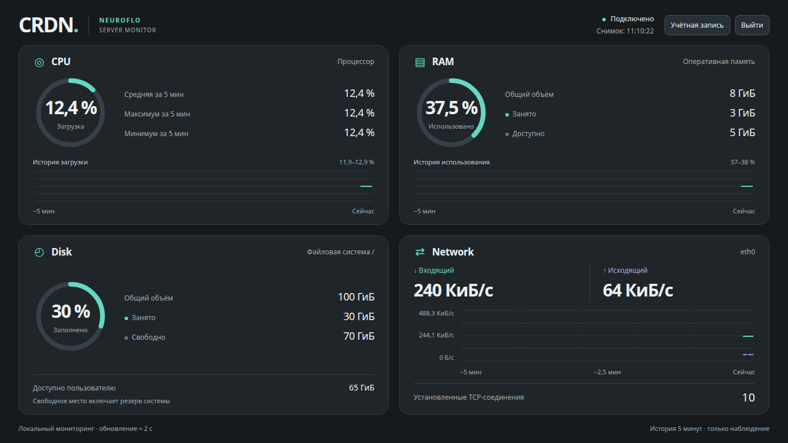

# CRDN — Server Monitor

**Лёгкая панель мониторинга Linux-сервера прямо в браузере.**

CRDN показывает загрузку процессора, использование оперативной памяти, заполнение диска и сетевую активность в реальном времени.

Без Docker, внешних сервисов мониторинга и тяжёлых баз данных.

**Язык документации:** Русский | [English](README.en.md)

[GitHub](https://github.com/GreyByDefault/CRDN-PUBLIC) · [Релизы](https://github.com/GreyByDefault/CRDN-PUBLIC/releases)

**v1.0.1 — стабильный выпуск с расширенным универсальным установщиком. Учётная запись и настройки сохраняются при обновлении.**

## Как выглядит CRDN



*Существующий интерфейс панели, снятый локально с демонстрационными значениями; без данных и секретов рабочего сервера.*

### Возможности

- **CPU** — текущая, средняя, минимальная и максимальная загрузка процессора.
- **RAM** — общий объём, занятая и доступная оперативная память.
- **Disk** — общий объём диска, занятое и свободное место.
- **Network** — входящая и исходящая скорость, количество установленных TCP-соединений.
- Обновление показателей каждые 2 секунды.
- Графики с историей последних 5 минут.
- Удобный интерфейс для компьютеров и смартфонов.
- Вход по логину и паролю с возможностью изменить их в настройках.

CRDN предназначен для наблюдения за сервером. Программа не управляет системными ресурсами и не изменяет их настройки.

После установки CRDN работает самостоятельно на вашем сервере и автоматически запускается после его перезагрузки. Метрики, учётные данные и настройки остаются на сервере. GitHub и зеркало NEUROFLO нужны для получения выпусков и сведений об обновлениях; их временная недоступность не останавливает мониторинг и вход.

---


### Название, меню и домашний экран

Меню ☰ открывает «Настройки», ручную проверку обновлений, «О приложении» и выход. Название сервера меняется отдельной кнопкой в настройках без смены учётной записи; максимум 24 символа Unicode, включая пробелы. Системный hostname не меняется, имя сохраняется при обновлении и откате. Для старых установок имя задаётся в панели без SSH. Под полем всегда виден остаток символов или результат проверки, без сдвига кнопки сохранения.

Тёмная тема включена по умолчанию. Светлая выбирается в «Настройках» и сохраняется только в этом браузере, включая страницу входа. На других устройствах выбор независим.

На Android откройте панель в поддерживаемом браузере и выберите в меню браузера «Установить приложение» или «Добавить на главный экран». CRDN открывается отдельным приложением с названием сервера. Его идентичность сохраняется при переименовании и обновлении. Android может оставить старую подпись после переименования: при необходимости переустановите только PWA-приложение/ярлык, а не серверный CRDN. Установка на Android, иконка и открытие отдельным приложением приняты пользователем. Офлайн-мониторинга и кеширования приватных данных нет.

## 1. Что понадобится для установки

Для установки CRDN необходимы:

- VPS/VDS, выделенный или собственный Linux-сервер.
- Ubuntu Server 22.04, 24.04, 26.04 LTS или Debian 12/13.
- Административный доступ к серверу по SSH.
- Домен или поддомен.
- Подключение сервера к интернету.

Для всех указанных систем требуется systemd. Степень проверки различается:

- **Подтверждено пользователем на реальном VPS:** Ubuntu Server 24.04 с Caddy — установка, обновление, удаление, повторная установка, HTTPS и браузерная авторизация.
- **Предусмотрены установщиком, без полной пользовательской приёмки:** Ubuntu Server 22.04/26.04 LTS, Debian 12/13 и интеграция с Nginx/Apache. Отдельные проверки компонентов и конфигураций Debian 12 не заменяют полного цикла установки и работы сертификатов для всех сочетаний.

Для запуска команд нужны Python 3, curl, sha256sum, tar и стандартные системные инструменты. Загрузчик сам получает комплект скриптов; вручную скачивать исходники, распаковывать архив или выбирать каталог не нужно. Команды работают через root или пользователя с sudo; запрос пароля sudo допустим.

CRDN работает на Linux-серверах. Обычный виртуальный хостинг не поддерживается.

Для установки не нужны Docker, отдельная база данных или платный сервис мониторинга.

## 2. Настройка домена

**Перед установкой CRDN необходимо привязать домен к IP-адресу сервера.**

Эта настройка выполняется в панели управления DNS вашего домена — например, в REG.RU, Cloudflare или другом сервисе, обслуживающем его DNS.

IP-адрес сервера можно найти в личном кабинете компании, у которой вы приобрели VPS.

Ниже показаны два варианта. Выберите тот, который подходит вам.

### Вариант А. Установка на основной домен

Предположим, вы приобрели домен:

`example.com`

И хотите, чтобы CRDN открывался непосредственно по адресу:

`https://example.com`

Откройте настройки DNS и добавьте запись:

| Поле | Что указать |
|---|---|
| Тип записи | `A` |
| Имя | `@` |
| Значение | `203.0.113.10` |
| TTL | По умолчанию |

`@` означает основной домен.

Некоторые DNS-провайдеры вместо `@` используют пустое поле или само имя домена. Следуйте обозначениям в панели вашего провайдера.

`203.0.113.10` — пример. Вместо него укажите **реальный публичный IPv4-адрес вашего сервера**.

После сохранения записи адрес `example.com` будет направлен на указанный сервер.

**Важно:** если на основном домене уже работает сайт, установка CRDN на тот же адрес потребует изменения существующей конфигурации. Для отдельной панели удобнее использовать поддомен.

### Вариант Б. Установка на поддомен

Предположим, ваш основной сайт находится по адресу:

`https://example.com`

А CRDN вы хотите разместить отдельно:

`https://monitor.example.com`

Для этого откройте настройки DNS и добавьте запись:

| Поле | Что указать |
|---|---|
| Тип записи | `A` |
| Имя | `monitor` |
| Значение | `203.0.113.10` |
| TTL | По умолчанию |

Здесь `monitor` — имя поддомена.

Вы можете выбрать другое имя, например `server`, `status` или `crdn`.

В поле значения укажите реальный публичный IPv4-адрес своего сервера.

После сохранения записи основной сайт продолжит работать по адресу `example.com`, а поддомен `monitor.example.com` будет направлен на тот же сервер.

**Для CRDN рекомендуем использовать отдельный поддомен.**

### Сколько ждать обновления DNS?

Обычно проверять результат можно через 10–15 минут. В некоторых случаях обновление занимает несколько часов.

Установщик CRDN автоматически проверяет, куда направлен ваш домен.

Если DNS ещё не обновился или указывает на другой сервер, установка останавливается и показывает понятное сообщение.

После исправления DNS просто запустите команду установки повторно.

Если у домена есть AAAA, она также должна указывать на публичный IPv6-адрес этого сервера. Установщик проверяет все A/AAAA; автоматическая установка через NAT/CDN не поддерживается. Для общего веб-сервера нужны доступные TCP 80/443. При чужом владельце стандартных портов используется отдельный HTTPS-порт; TCP 80 всё равно нужен для HTTP-01. Установщик может добавить только собственные помеченные разрешения в поддерживаемый локальный firewall. Firewall провайдера не изменяется; внешняя доступность не гарантируется локальной проверкой.

## 3. Подключение к серверу

Для установки CRDN необходимо подключиться к своему Linux-серверу по SSH.

**Windows:** откройте PowerShell или Windows Terminal.

**Linux и macOS:** откройте приложение «Терминал».

Введите:

```bash
ssh root@203.0.113.10
```

Вместо `203.0.113.10` укажите IP-адрес своего сервера.

Если ваш провайдер выдал другое имя пользователя, укажите его вместо `root`. Для установки потребуются права администратора через `sudo`.

При первом подключении SSH может запросить подтверждение ключа сервера. Сверьте его отпечаток с информацией вашего провайдера.

После успешного подключения можно переходить к установке CRDN.

<a name="установка"></a>

## 4. Установка CRDN

Скопируйте установочную команду и выполните её на сервере.

```sh
bash -c 'set -eu; d=$(mktemp -d); trap "rm -rf -- \"$d\"" EXIT; cd "$d"; v=v1.0.1; f() { curl --silent --show-error --fail --location --connect-timeout 4 --max-time 10 --max-filesize "${3:-262144}" --proto =https --proto-redir =https -o "$2" "$1/$2"; }; pair() { f "$1" crdn-bootstrap.sh && f "$1" crdn-bootstrap.sh.sha256 1024; }; if ! pair "https://github.com/GreyByDefault/CRDN-PUBLIC/releases/download/$v"; then pair "https://neuroflo.ru/crdn-files/releases/$v"; fi; [[ "$(cat crdn-bootstrap.sh.sha256)" =~ ^[0-9a-f]{64}"  crdn-bootstrap.sh"$ ]]; sha256sum --status -c crdn-bootstrap.sh.sha256; sh ./crdn-bootstrap.sh install --release "$v" < /dev/tty'
```

Вставьте одну строку в SSH-сеанс. Команда получает shell-загрузчик и его SHA-256 с GitHub, при сетевой ошибке — с зеркала того же тега; проверяет точное имя и сумму до запуска. Загрузчик затем получает и проверяет полный комплект из официального Release и вызывает существующий установщик. При ошибке HTTPS или контрольной суммы выполнение прекращается. Ввод домена и пароля sudo остаётся интерактивным через /dev/tty при запуске загрузчика из временного файла. Эта команда явно выбирает стабильный v1.0.1; production HTTPS включён по умолчанию, без ACME staging.

После запуска установщик самостоятельно:

1. Проверяет операционную систему и ресурсы сервера.
2. Проверяет наличие необходимых программ; при необходимости устанавливает Caddy или Certbot. Базовые инструменты из раздела 1 должны быть доступны заранее.
3. Определяет установленный веб-сервер: Caddy, Nginx или Apache.
4. Просит указать домен или поддомен и название сервера (до 24 символов, включая пробелы).
5. Проверяет DNS и доступность необходимых сетевых портов.
6. Скачивает CRDN из официального Release: по умолчанию стабильную версию, в приведённой команде — явно выбранный v1.0.1.
7. Устанавливает приложение и настраивает его автоматический запуск.
8. Подключает панель к веб-серверу и настраивает HTTPS.
9. Проверяет работу приложения и выводит адрес готовой панели.

**Во время установки вам потребуется указать домен или поддомен и название сервера.** Остальные действия выполняются автоматически.

### Если на сервере уже есть сайты

CRDN поддерживает Caddy, Nginx и Apache.

Установщик определяет существующий веб-сервер и добавляет конфигурацию панели, сохраняя работу остальных сайтов.

Если веб-сервер отсутствует, устанавливается и настраивается Caddy.

Если обнаружен конфликт, который нельзя устранить безопасно, установка останавливается и сообщает причину. Существующие сайты и службы остаются без изменений.

В v1.0.1, если стандартные порты заняты чужими приложениями, выбирается отдельный экземпляр Nginx с собственной конфигурацией и systemd-службой. HTTPS-порт определяется автоматически: сначала 8443, 9443, 10443, 11443, 12443, затем другие свободные непривилегированные порты вне системных резервов. Полный адрес с портом выводится после установки. Постоянно занятый TCP 80 не поддерживается в этом режиме: установщик не останавливает его владельца.

Для Nginx/Apache поддержаны проверенный root acme.sh с отдельным сертификатом CRDN и существующим общим cron либо пакетный Certbot с подходящим общим timer. При необходимости создаётся отдельный timer и хранилище; при отсутствии поддерживаемого клиента устанавливается Certbot. Caddy использует встроенный HTTPS. Чужие сертификаты не заменяются, DNS-01 не реализован.

Поддержаны ограниченные схемы UFW, firewalld, nftables и iptables. Добавленные правила принадлежат CRDN и удаляются вместе с ним; общие правила не сбрасываются. Открытие закрытого общего веб-порта, которое могло бы раскрыть соседние сайты, отклоняется. Неизвестные ACME-расписания, snap/venv Certbot, сложные firewall, панели управления и нестандартные конфигурации могут потребовать ручного разбора. Установленные пакеты и общий веб-сервер после удаления сохраняются.

Практически подтверждены Ubuntu 24.04+Caddy и отдельный цикл установки/обновления/удаления рядом с 3x-ui/Xray, acme.sh, Fail2ban и UFW на Ubuntu 24.04. Автоматические тесты и отдельные Debian 12 VM-проверки не заменяют полную матрицу ОС и окружений. Реальное последующее продление сертификата и пользовательская проверка VPN в этом цикле не подтверждены; дальнейшие испытания проводятся отдельно.

## 5. Первый вход в CRDN

После завершения установки откройте в браузере адрес панели, который сообщил установщик.

Например:

`https://monitor.example.com`

Первоначальные данные для новой установки без сохранённой учётной записи:

**Логин:** `admin`

**Пароль:** `admin`

После входа появится уведомление с предложением изменить логин и пароль.

Выберите «Изменить», чтобы установить собственные данные, или «Отмена», чтобы продолжить работу со стандартными.

Позднее логин и пароль можно изменить в настройках учётной записи. Поля идут по порядку: текущий логин (только для чтения), текущий пароль, новый логин, новый пароль и повтор нового пароля. Новый логин пустой: чтобы сохранить прежний, введите его снова. У всех парольных полей есть «Показать/Скрыть»; при открытии они скрыты. Пока исходная запись ни разу не изменялась, текущие данные заполнены admin/admin даже после отказа от напоминания. После первой сохранённой смены текущий пароль всегда вводится вручную; обновление сохраняет действующие данные.

**Настоятельно рекомендуем сменить стандартные данные сразу после установки.**

Комбинация `admin / admin` общеизвестна. Пока она используется, любой человек, знающий адрес панели, может получить к ней доступ.

## 6. Обновление CRDN

Новые версии публикуются в разделе [GitHub Releases](https://github.com/GreyByDefault/CRDN-PUBLIC/releases).

Для обновления используется отдельная команда:

```sh
bash -c 'set -eu; d=$(mktemp -d); trap "rm -rf -- \"$d\"" EXIT; cd "$d"; v=v1.0.1; f() { curl --silent --show-error --fail --location --connect-timeout 4 --max-time 10 --max-filesize "${3:-262144}" --proto =https --proto-redir =https -o "$2" "$1/$2"; }; pair() { f "$1" crdn-bootstrap.sh && f "$1" crdn-bootstrap.sh.sha256 1024; }; if ! pair "https://github.com/GreyByDefault/CRDN-PUBLIC/releases/download/$v"; then pair "https://neuroflo.ru/crdn-files/releases/$v"; fi; [[ "$(cat crdn-bootstrap.sh.sha256)" =~ ^[0-9a-f]{64}"  crdn-bootstrap.sh"$ ]]; sha256sum --status -c crdn-bootstrap.sh.sha256; sh ./crdn-bootstrap.sh update --release "$v" --disable-rc-updates < /dev/tty'
```

Команду можно выполнить из любого каталога. Она выбирает стабильный v1.0.1 и явно отключает тестовый RC-канал. Действующие учётные данные и настройки сохраняются. Без точного `--release` загрузчики выбирают только последний стабильный выпуск; если он недоступен, операция останавливается.

На установленной rc.16 выберите меню ☰ → «Проверить обновления», затем кнопку обновления в шапке. Прочитайте «Что нового» и подтвердите обновление; переустановка не нужна. При браузерном переходе с RC на stable ранее включённый RC-канал сохраняется. Чтобы вернуться только к стабильным обновлениям, выполните ручную команду выше: флаг `--disable-rc-updates` безопасно меняет канал, в том числе если v1.0.1 уже установлен. Одного отсутствия `--enable-rc-updates` недостаточно для отключения ранее включённого канала.

Проверка выпусков выполняется асинхронно при запуске и затем не чаще раза в сутки. Ручная проверка — меню ☰ → «Проверить обновления», с ограничением частоты. GitHub — основной источник, зеркало — резервный. Этапы и подтверждённый результат показывает окно обновления; после перезапуска требуется новый вход. Принятие запроса не означает успешного обновления.

Окно подтверждения показывает «Что нового» для предлагаемой версии: добавления и исправления из её release notes. GitHub — основной источник описания, зеркало — резервный. Если описания нет, обновление всё равно можно подтвердить.

При обновлении сохраняются:

- Ваш логин и пароль.
- Домен или поддомен.
- Настройки HTTPS.
- Конфигурация службы CRDN.
- Название сервера и остальные пользовательские настройки приложения.

Выбранная тема остаётся в каждом браузере независимо.

После обновления панель продолжает работать по прежнему адресу. Повторная первоначальная настройка не требуется.

### Стабильный и тестовый RC-каналы

- **Stable** — стабильные выпуски для обычной работы. Этот канал используется новой установкой по умолчанию. Команды этой страницы явно выбирают стабильный v1.0.1.
- **RC (Release Candidate)** — предварительные тестовые выпуски. Для установки нужен явный `--release vX.Y.Z-rc.N`, а для предложений следующих RC — `--enable-rc-updates`. В этом канале предлагаются и стабильные выпуски.

Канал указан в «О приложении». Stable-only никогда не переключается на RC автоматически. Флаг `--disable-rc-updates` ручной команды обновления возвращает установленную панель в stable-only; сбрасывать учётную запись или название сервера не требуется.

## 7. Удаление CRDN

Для удаления программы предусмотрена отдельная команда:

```sh
bash -c 'set -eu; d=$(mktemp -d); trap "rm -rf -- \"$d\"" EXIT; cd "$d"; v=v1.0.1; f() { curl --silent --show-error --fail --location --connect-timeout 4 --max-time 10 --max-filesize "${3:-262144}" --proto =https --proto-redir =https -o "$2" "$1/$2"; }; pair() { f "$1" crdn-bootstrap.sh && f "$1" crdn-bootstrap.sh.sha256 1024; }; if ! pair "https://github.com/GreyByDefault/CRDN-PUBLIC/releases/download/$v"; then pair "https://neuroflo.ru/crdn-files/releases/$v"; fi; [[ "$(cat crdn-bootstrap.sh.sha256)" =~ ^[0-9a-f]{64}"  crdn-bootstrap.sh"$ ]]; sha256sum --status -c crdn-bootstrap.sh.sha256; sh ./crdn-bootstrap.sh uninstall --release "$v" < /dev/tty'
```

Команда работает из любого каталога. Номер выпуска здесь выбирает проверенный комплект инструментов удаления, а не версию удаляемой установки.

Скрипт останавливает службу, удаляет файлы приложения и созданную для CRDN конфигурацию веб-сервера.

Другие сайты, службы и приложения на сервере остаются без изменений.

Удаление полное: удаляются приложение, его конфигурация и все принадлежащие CRDN пользовательские данные, включая учётную запись, без отдельного вопроса об их сохранении. Внешние резервные копии и общие сертификаты Caddy не затрагиваются. После успешного удаления новая установка создаёт admin/admin. Если завершающая очистка прервалась, повторите команду удаления: уже удалённые известные файлы допустимы, а изменённые или неожиданные ресурсы останавливают автоматическую очистку.

## 8. Возможные проблемы

### Домен не открывается

Проверьте DNS-запись A. Она должна указывать на публичный IP-адрес вашего сервера.

Если запись только что добавлена, подождите и повторите попытку.

### HTTPS не работает

Убедитесь, что DNS настроен правильно, а необходимые сетевые порты доступны из интернета.

CRDN использует HTTPS для безопасного подключения к панели.

### На сервере уже работает сайт

Удалять существующий сайт или веб-сервер не нужно.

CRDN устанавливается рядом с существующими проектами. Поддерживаются Caddy, Nginx и Apache.

### Система не поддерживается

Проверьте версию Linux. Список целевых систем приведён в первом разделе инструкции.

### Забыли логин или пароль

Отдельная команда безопасного восстановления забытого логина или пароля пока не реализована. Не удаляйте файл учётной записи ради сброса: это уничтожит сохранённые данные. Почтового восстановления нет. Если текущий пароль известен, используйте смену данных в настройках учётной записи.

## 9. Исходный код и лицензия

CRDN — открытый проект NEUROFLO.

- [Исходный код на GitHub](https://github.com/GreyByDefault/CRDN-PUBLIC)
- [Официальные релизы](https://github.com/GreyByDefault/CRDN-PUBLIC/releases)
- Лицензия MIT.

---

**CRDN Server Monitor — только необходимые показатели. Ничего лишнего.**
